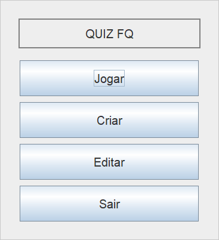
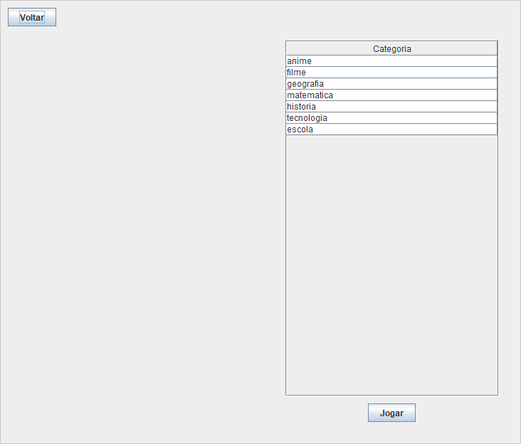
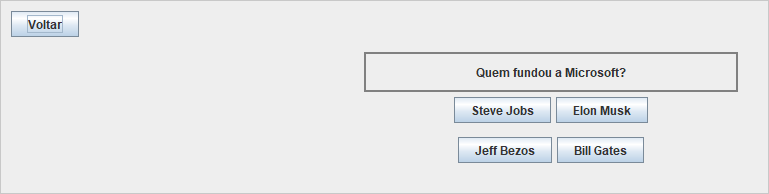
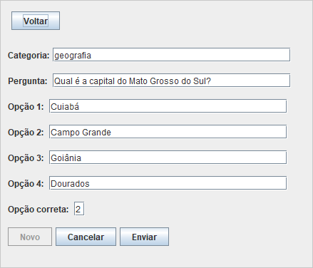
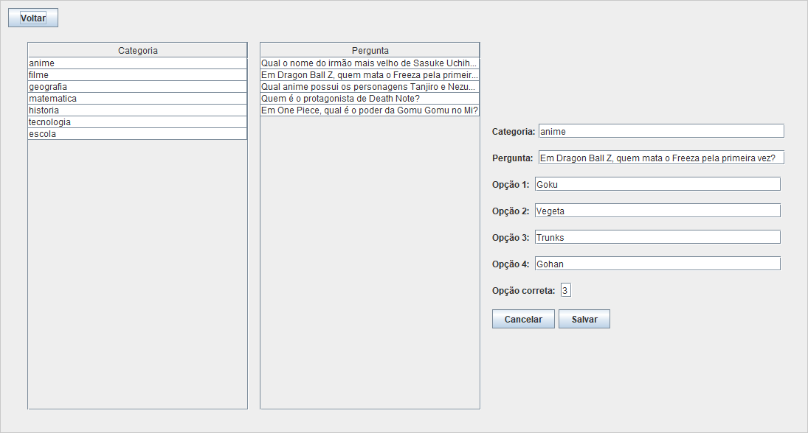

# 🎯 Quiz FQ

Jogo de perguntas e respostas para desktop feito em **Java Swing**, desenvolvido como projeto da disciplina de **Linguagem de Programação II** do curso de **Tecnologia em Sistemas para Internet (TSI) — IFMS**.

O jogador escolhe uma categoria e precisa acertar **5 perguntas seguidas** para vencer. Errou uma, volta para o início! As perguntas podem ser criadas e editadas pelo próprio programa e ficam salvas em um arquivo JSON.

<p align="center">
  
</p>

## ✨ Funcionalidades

- **Jogar** — escolha uma categoria e responda 5 perguntas sorteadas aleatoriamente (sem repetição).
- **Criar** — cadastre novas perguntas com categoria, 4 alternativas e a resposta correta.
- **Editar** — navegue pelas categorias, selecione uma pergunta e altere qualquer campo.
- **Validações** — campos obrigatórios, seleção de categoria e mínimo de 5 perguntas por categoria para poder jogar (com exceções personalizadas).
- **Persistência em JSON** — as perguntas ficam salvas em `Perguntas.json` usando a biblioteca Gson.

## 📸 Telas

### Escolha da categoria


### Jogando


### Criando uma pergunta


### Editando perguntas


## 🛠️ Tecnologias

| Tecnologia | Uso |
|---|---|
| Java 17+ | Linguagem principal |
| Swing | Interface gráfica |
| [Gson](https://github.com/google/gson) | Leitura e gravação dos arquivos JSON |
| [Towel](https://github.com/rodrigocananea/towel-project) | `ObjectTableModel` para exibir objetos em `JTable` |
| Maven | Gerenciamento de dependências |

## 🧱 Estrutura do projeto

```
src/main/java/br/ifms/edu/tsi/lpii/
├── Main.java                     # Ponto de entrada
├── JanelaInicio.java             # Menu principal
├── JanelaSelecionar.java         # Escolha da categoria
├── JanelaJogar.java              # Tela do jogo
├── JanelaForm.java               # Cadastro de perguntas
├── JanelaEditar.java             # Edição de perguntas
├── Perguntas.java                # Modelo (pergunta, opções, resposta, categoria)
├── DataSourceInterface.java      # Contrato CRUD genérico
├── AbstractDataSource.java       # Base com Gson
├── DataSourceJSON.java           # Implementação que salva em JSON
├── Validador.java                # Regras de validação
└── *Exception.java               # Exceções personalizadas
```

O acesso aos dados segue um padrão em camadas: `DataSourceInterface<T>` define o contrato (`salvar`, `remover`, `listar`, `buscarPorId`), `AbstractDataSource<T>` fornece a base comum e `DataSourceJSON` implementa a persistência em arquivo. Assim, seria possível trocar o JSON por um banco de dados sem mexer nas telas.

## ▶️ Como executar

**Pré-requisitos:** Java 17 ou superior e Maven.

```bash
git clone https://github.com/ViniciusOliveira50/quiz-fq.git
```

```bash
cd quiz-fq
```

```bash
mvn compile exec:java
```

Ou abra o projeto no **Eclipse / IntelliJ** como projeto Maven e execute a classe `br.ifms.edu.tsi.lpii.Main`.

> ⚠️ Execute a partir da pasta raiz do projeto: os arquivos `Perguntas.json` e `contador.json` são lidos do diretório atual.
>
> O jogo abre em **tela cheia**. Use o botão **Sair** no menu inicial para fechar.

## 📝 Formato das perguntas

Cada pergunta em `Perguntas.json` segue este formato (`idRespostaCorreta` vai de 1 a 4):

```json
{
  "id": 1,
  "pergunta": "Qual o nome do irmão mais velho de Sasuke Uchiha?",
  "opcoes": ["Itachi", "Naruto", "Madara", "Kakashi"],
  "idRespostaCorreta": 1,
  "categoria": "anime"
}
```

O projeto já vem com perguntas nas categorias **anime, filme, geografia, matemática, história e tecnologia**.

## 👤 Autor

**Vinicius de Oliveira** — [@ViniciusOliveira50](https://github.com/ViniciusOliveira50)

---

Projeto acadêmico — IFMS · Tecnologia em Sistemas para Internet
